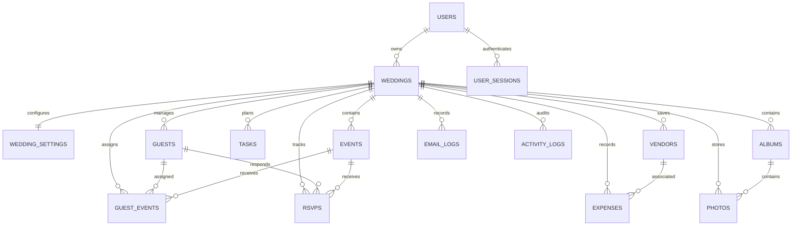

# Make My Marriage — Database Design Document (DDD)
**Version:** 2.0 | **Status:** Draft for review | **Database:** MongoDB Atlas (`MONGODB_DB_NAME`, default `mmm-db`) | **ODM:** Mongoose

## 1. Design principles
Shared collections, logically tenant-isolated by `weddingId`. One user owns many weddings; one owner per wedding in v2.0; guests are accountless. Internal IDs are ObjectIds. Store UTC timestamps; render in wedding timezone. All wedding documents include `weddingId`. Client ID is not authorization.

## 2. Collections
`users`, `user_sessions`, `email_verification_tokens`, `password_reset_tokens`, `auth_rate_limits`, `weddings`, `wedding_settings`, `events`, `guests`, `guest_events`, `rsvps`, `tasks`, `expenses`, `vendors`, `albums`, `photos`, `email_logs`, `activity_logs`.

## 3. ER diagram


## 4. Schema summary
- **users:** `_id`, fullName, email, normalizedEmail, passwordHash, status (ACTIVE/PENDING_VERIFICATION/SUSPENDED), emailVerifiedAt, lastLoginAt, timestamps.
- **user_sessions:** `_id`, userId, sessionTokenHash, expiresAt, revokedAt, timestamps.
- **email_verification_tokens / password_reset_tokens:** `_id`, userId, tokenHash, expiresAt, usedAt, timestamps. Single-use, hashed, app-enforced expiry.
- **weddings:** `_id`, ownerUserId, weddingName, unique slug, partnerOneName, partnerTwoName, city, weddingDate, weddingDateIsTentative, timezone, contactEmail/Phone, status (DRAFT/ACTIVE/ARCHIVED/DELETED), publishedAt, timestamps. The owner creates the first workspace from the authenticated dashboard after registering and signing in.
- **auth_rate_limits:** HMAC-hashed action/client key, attempt count, expiry timestamp; TTL cleanup. No raw IP address or email is stored.
- **wedding_settings:** weddingId unique; theme; website publication, description, countdown, livestream; RSVP defaults/deadline updates; gallery enabled/visibility; email invitation/reminder toggles.
- **events:** weddingId, name/type, description, startDate/endDate/timezone, venue object (address, GeoJSON Point, Place ID, directions URL), RSVP deadline, maxAttendees, dressCode, notes, status (DRAFT/PUBLISHED/CANCELLED), timestamps.
- **guests:** weddingId, fullName, email/normalizedEmail, phone, groupName, invitationTokenHash, invitationStatus, invitationSentAt, notes, timestamps.
- **guest_events:** weddingId, guestId, eventId, maxAttendees; checkIn status/time/count/notes; timestamps.
- **rsvps:** weddingId, guestId, eventId, status (PENDING/YES/NO), attendeeCount, respondedAt, guestMessage, timestamps.
- **tasks:** weddingId, title, description, category, priority (LOW/MEDIUM/HIGH/URGENT), status (TODO/IN_PROGRESS/COMPLETED/CANCELLED), dueDate, completedAt, notes, timestamps.
- **expenses:** weddingId, name, category, amountMinor integer, currency ISO 4217, expenseDate, optional vendorId, paymentStatus, notes, timestamps. Actual expenses only.
- **vendors:** weddingId, name/category, phone/email/address/website, googlePlaceId, ratingSnapshot, notes, timestamps.
- **albums:** weddingId, name/description, accessMode (PRIVATE/LINK_ACCESS), albumTokenHash, isPublished, timestamps.
- **photos:** weddingId, albumId, uploadedByUserId/GuestId, storageProvider R2, objectKey unique, originalFileName, contentType, sizeBytes, dimensions, checksum, status (PENDING/READY/FAILED/DELETED), timestamps.
- **email_logs:** weddingId, guestId/eventId nullable, emailType, provider Resend, providerMessageId, recipientEmail, status, sent/delivered times, failureReason, unique idempotencyKey, timestamps.
- **activity_logs:** weddingId, actorUserId, action, entityType/entityId, metadata, ipAddressHash, createdAt. Never store tokens/secrets.

## 5. Required indexes
```javascript
db.users.createIndex({ normalizedEmail: 1 }, { unique: true });
db.user_sessions.createIndex({ sessionTokenHash: 1 }, { unique: true });
db.user_sessions.createIndex({ expiresAt: 1 }, { expireAfterSeconds: 0 });
db.email_verification_tokens.createIndex({ tokenHash: 1 }, { unique: true });
db.email_verification_tokens.createIndex({ expiresAt: 1 }, { expireAfterSeconds: 0 });
db.password_reset_tokens.createIndex({ tokenHash: 1 }, { unique: true });
db.password_reset_tokens.createIndex({ expiresAt: 1 }, { expireAfterSeconds: 0 });
db.weddings.createIndex({ ownerUserId: 1, createdAt: -1 });
db.weddings.createIndex({ slug: 1 }, { unique: true });
db.auth_rate_limits.createIndex({ keyHash: 1 }, { unique: true });
db.auth_rate_limits.createIndex({ expiresAt: 1 }, { expireAfterSeconds: 0 });
db.wedding_settings.createIndex({ weddingId: 1 }, { unique: true });
db.events.createIndex({ weddingId: 1, startDate: 1 });
db.events.createIndex({ weddingId: 1, status: 1, startDate: 1 });
db.events.createIndex({ "venue.location": "2dsphere" });
db.guests.createIndex({ weddingId: 1, createdAt: -1 });
db.guests.createIndex({ invitationTokenHash: 1 }, { unique: true });
db.guest_events.createIndex({ weddingId: 1, guestId: 1, eventId: 1 }, { unique: true });
db.rsvps.createIndex({ weddingId: 1, guestId: 1, eventId: 1 }, { unique: true });
db.rsvps.createIndex({ weddingId: 1, eventId: 1, status: 1 });
db.tasks.createIndex({ weddingId: 1, status: 1, dueDate: 1 });
db.expenses.createIndex({ weddingId: 1, expenseDate: -1 });
db.vendors.createIndex({ weddingId: 1, category: 1, name: 1 });
db.albums.createIndex({ weddingId: 1, createdAt: -1 });
db.photos.createIndex({ weddingId: 1, albumId: 1, createdAt: -1 });
db.photos.createIndex({ objectKey: 1 }, { unique: true });
db.email_logs.createIndex({ idempotencyKey: 1 }, { unique: true });
db.activity_logs.createIndex({ weddingId: 1, createdAt: -1 });
```
TTL indexes are cleanup only; application must reject expired/revoked tokens even if MongoDB TTL has not yet deleted them.

## 6. Integrity and validation
- Normalize email; unique normalized user email; unique wedding slug.
- `weddingId` required on every tenant-owned record.
- Event start precedes end; capacity positive when supplied; timezone is valid IANA.
- Guest/event must share wedding for assignment and RSVP; assignment unique.
- One RSVP per wedding+guest+event. YES attendeeCount >= 1; NO/PENDING count 0.
- RSVP only for assigned event; deadline and capacity enforced in application.
- Check-in count bounded by permitted guest-event attendance.
- Expense amount is integer nonnegative minor units; currency valid.
- Album/photo same wedding; objectKey unique; R2 object private.
- Email idempotency key unique; webhook signature verified and duplicate events safely ignored.

## 7. Tenant authorization/query pattern
```javascript
const wedding = await Wedding.findOne({
  _id: weddingId,
  ownerUserId: authenticatedUserId,
  status: { $ne: "DELETED" }
});
if (!wedding) throw new NotFoundError();

const event = await Event.findOne({
  _id: eventId,
  weddingId: wedding._id
});
```
Avoid unscoped `findById(entityId)` on wedding-private entities. Derive user ID from validated session. Scope cache, background jobs, aggregation `$match`, and storage key context by wedding.

## 8. Lifecycle and recovery
Archive: restrict writes; optionally unpublish and revoke invitation/album links; retain owner review per policy. Delete: soft-delete workspace, disable site, revoke links, stop pending email, remove R2 objects through controlled cleanup, then retention-based purge. User deletion requires identity/intent verification, session revocation, wedding retention/deletion policy, and legal retention assessment. Backups must be encrypted, access controlled and restore-tested.

## 9. Operational safeguards
Least privilege MongoDB credentials; secret manager/environment variables; index deployment reviewed; audit trail for owner actions; logs omit secrets, raw tokens and unnecessary PII; monitor slow queries/index use; verify backup and R2 cleanup. MongoDB does not enforce cross-collection foreign keys—application services validate relationships.

## 10. Database initialization
Run `npm run db:init` to create the documented collections and indexes in the configured database. The script is idempotent and does not insert sample users or wedding data; sign-up creates the account, and the first wedding workspace is created from the authenticated dashboard.
