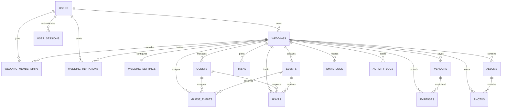

# Make My Marriage — Database Design Document (DDD)

**Version:** 2.0 | **Status:** Draft for review | **Database:** MongoDB Atlas (`MONGODB_DB_NAME`, default `mmm-db`) | **ODM:** Mongoose

## 1. Design principles

Shared collections, logically tenant-isolated by `weddingId`. One user owns many weddings; each wedding has one owner and may have invited Admin/Manager members. Guests remain accountless. Internal IDs are ObjectIds. Store UTC timestamps; render in wedding timezone. All wedding documents include `weddingId`. Client ID is not authorization.

## 2. Collections

`users`, `user_sessions`, `email_verification_tokens`, `password_reset_tokens`, `auth_rate_limits`, `weddings`, `wedding_settings`, `wedding_memberships`, `wedding_invitations`, `events`, `guests`, `guest_events`, `rsvps`, `tasks`, `expenses`, `vendors`, `albums`, `photos`, `email_logs`, `activity_logs`.

## 3. ER diagram



## 4. Schema summary

- **users:** `_id`, fullName, email, normalizedEmail, passwordHash, status (ACTIVE/PENDING_VERIFICATION/SUSPENDED), emailVerifiedAt, lastLoginAt, timestamps.
- **user_sessions:** `_id`, userId, sessionTokenHash, expiresAt, revokedAt, timestamps.
- **email_verification_tokens / password_reset_tokens:** `_id`, userId, tokenHash, expiresAt, usedAt, timestamps. Single-use, hashed, app-enforced expiry.
- **weddings:** `_id`, ownerUserId, weddingName, unique slug, partnerOneName, partnerTwoName, city, weddingDate, weddingDateIsTentative, timezone, contactEmail/Phone, status (DRAFT/ACTIVE/ARCHIVED/DELETED), publishedAt, timestamps. The owner creates the first workspace from the authenticated dashboard after registering and signing in.
- **wedding_memberships:** weddingId, userId, role (ADMIN/MANAGER), invitedByUserId, joinedAt, timestamps. Unique `(weddingId,userId)`. The owner remains in `weddings.ownerUserId` and is not duplicated as a membership.
- **wedding_invitations:** weddingId, invitedByUserId, email/normalizedEmail, role (ADMIN/MANAGER), tokenHash, activeInvitationKey (unique sparse wedding/email key while active), expiresAt, acceptedAt, revokedAt, deliveryStatus (PENDING/SENT/FAILED), sentAt, deliveryError, timestamps. Raw tokens are never stored. Retain accepted/revoked/expired records for invitation history; expiry is app-enforced, not TTL-deleted.
- **auth_rate_limits:** HMAC-hashed action/client key, attempt count, expiry timestamp; TTL cleanup. No raw IP address or email is stored.
- **wedding_settings:** weddingId unique; theme; website publication, description (up to 1,200 characters), countdown, livestream; RSVP defaults/deadline updates; gallery enabled/visibility; email invitation/reminder toggles. Wedding title is stored as `weddings.weddingName`.
- **events:** weddingId, name/type, description, startDate/endDate/timezone, venue object (address, GeoJSON Point, Place ID, directions URL), RSVP deadline, maxAttendees, dressCode, notes, status (DRAFT/PUBLISHED/CANCELLED), timestamps.
- **guests:** weddingId, fullName, email/normalizedEmail, phone, groupName, invitationTokenHash, invitationStatus, invitationSentAt, notes, timestamps.
- **guest_events:** weddingId, guestId, eventId, maxAttendees; checkIn status/time/count/notes; timestamps.
- **rsvps:** weddingId, guestId, eventId, status (PENDING/YES/NO), attendeeCount, respondedAt, guestMessage, timestamps.
- **tasks:** weddingId, title, description, category, priority (LOW/MEDIUM/HIGH/URGENT), status (TODO/IN_PROGRESS/COMPLETED/CANCELLED), dueDate, completedAt, notes, timestamps.
- **expenses:** weddingId, name, category, amountMinor integer, currency ISO 4217, expenseDate, optional vendorId, paymentStatus, notes, timestamps. Actual expenses only.
- **vendors:** weddingId, name/category, phone/email/address/website, googlePlaceId, ratingSnapshot, notes, timestamps.
- **albums:** weddingId, name/description, accessMode (PRIVATE/LINK_ACCESS), albumTokenHash, isPublished, timestamps.
- **photos:** weddingId, albumId, uploadedByUserId/GuestId, storageProvider R2, objectKey unique, originalFileName, contentType, sizeBytes, dimensions, checksum, status (PENDING/READY/FAILED/DELETED), timestamps.
- **email_logs:** weddingId, guestId/eventId nullable, emailType, provider Resend, providerMessageId, recipientEmail, status, sent/delivered times, failureReason, unique idempotencyKey, timestamps.
- **activity_logs:** weddingId, actorUserId, action, entityType/entityId, metadata, ipAddressHash, createdAt. Never store tokens/secrets.

## 5. Required indexes

```javascript
db.users.createIndex({ normalizedEmail: 1 }, { unique: true });
db.user_sessions.createIndex({ sessionTokenHash: 1 }, { unique: true });
db.user_sessions.createIndex({ expiresAt: 1 }, { expireAfterSeconds: 0 });
db.email_verification_tokens.createIndex({ tokenHash: 1 }, { unique: true });
db.email_verification_tokens.createIndex(
  { expiresAt: 1 },
  { expireAfterSeconds: 0 },
);
db.password_reset_tokens.createIndex({ tokenHash: 1 }, { unique: true });
db.password_reset_tokens.createIndex(
  { expiresAt: 1 },
  { expireAfterSeconds: 0 },
);
db.weddings.createIndex({ ownerUserId: 1, createdAt: -1 });
db.weddings.createIndex({ slug: 1 }, { unique: true });
db.auth_rate_limits.createIndex({ keyHash: 1 }, { unique: true });
db.auth_rate_limits.createIndex({ expiresAt: 1 }, { expireAfterSeconds: 0 });
db.wedding_settings.createIndex({ weddingId: 1 }, { unique: true });
db.wedding_memberships.createIndex(
  { weddingId: 1, userId: 1 },
  { unique: true },
);
db.wedding_memberships.createIndex({ userId: 1, joinedAt: -1 });
db.wedding_invitations.createIndex({ tokenHash: 1 }, { unique: true });
db.wedding_invitations.createIndex({
  weddingId: 1,
  normalizedEmail: 1,
  acceptedAt: 1,
  revokedAt: 1,
});
db.wedding_invitations.createIndex({ weddingId: 1, createdAt: -1 });
db.wedding_invitations.createIndex({ expiresAt: 1 });
db.wedding_invitations.createIndex(
  { activeInvitationKey: 1 },
  { unique: true, sparse: true },
);
db.events.createIndex({ weddingId: 1, startDate: 1 });
db.events.createIndex({ weddingId: 1, status: 1, startDate: 1 });
db.events.createIndex({ "venue.location": "2dsphere" });
db.guests.createIndex({ weddingId: 1, createdAt: -1 });
db.guests.createIndex({ invitationTokenHash: 1 }, { unique: true });
db.guest_events.createIndex(
  { weddingId: 1, guestId: 1, eventId: 1 },
  { unique: true },
);
db.rsvps.createIndex(
  { weddingId: 1, guestId: 1, eventId: 1 },
  { unique: true },
);
db.rsvps.createIndex({ weddingId: 1, eventId: 1, status: 1 });
db.tasks.createIndex({ weddingId: 1, status: 1, dueDate: 1 });
db.expenses.createIndex({ weddingId: 1, expenseDate: -1 });
db.vendors.createIndex({ weddingId: 1, category: 1, name: 1 });
db.albums.createIndex({ weddingId: 1, createdAt: -1 });
db.photos.createIndex({ weddingId: 1, albumId: 1, createdAt: -1 });
db.photos.createIndex({ objectKey: 1 }, { unique: true });
db.email_logs.createIndex({ idempotencyKey: 1 }, { unique: true });
db.activity_logs.createIndex({ weddingId: 1, createdAt: -1 });
```

TTL indexes are cleanup only; application must reject expired/revoked tokens even if MongoDB TTL has not yet deleted them.

## 6. Integrity and validation

Tasks increment (2026-11-19): `tasks` includes `assignedUserId` (nullable ObjectId), `eventId` (nullable ObjectId), `deletedAt` (nullable UTC Date), and `completedAt` (nullable UTC Date). `dueDate` is nullable `YYYY-MM-DD` text, representing a calendar date in the wedding timezone, not a midnight UTC instant. Title is 1–160 characters; description/notes up to 2,000, category up to 100. Defaults: TODO status, MEDIUM priority, empty optional text, null optional links/date. Initial completion or a transition to COMPLETED sets completedAt; reopening clears it. Assignment validation checks current membership/active user and same-wedding active events. Existing unavailable references may be retained unchanged for history. Add indexes `(weddingId, assignedUserId, dueDate)` and `(weddingId, eventId, dueDate)` alongside the existing status/dueDate index; `scripts/init-db.mjs` provisions these. Deleted tasks are excluded from all counts; dashboard pending tasks count only TODO/IN_PROGRESS. All read/update/delete filters include weddingId.

Events increment (2026-11-18): `endDate` is nullable when undecided. The implemented venue fields are `venue.name` and `venue.address`; Places/GeoJSON fields remain planned. `description`, `dressCode`, and `notes` default to empty strings; `rsvpDeadline` and `maxAttendees` default to null. `deletedAt` defaults to null and is set on removal together with CANCELLED status. Lists/reads exclude deleted records and dashboard planned-event counts also exclude CANCELLED. API edits compare `updatedAt` to reject stale writes. Existing wedding/start and wedding/status/start indexes are reused; no new collection or index migration is required.

- Normalize email; unique normalized user email; unique wedding slug.
- `weddingId` required on every tenant-owned record.
- Event start precedes end; capacity positive when supplied; timezone is valid IANA.
- Guest/event must share wedding for assignment and RSVP; assignment unique.
- One RSVP per wedding+guest+event. YES attendeeCount >= 1; NO/PENDING count 0.
- RSVP only for assigned event; deadline and capacity enforced in application.
- Check-in count bounded by permitted guest-event attendance.
- Expense amount is integer nonnegative minor units; currency valid.
- Album/photo same wedding; objectKey unique; R2 object private.
- Email idempotency key unique; webhook signature verified and duplicate events safely ignored.

## 7. Tenant authorization/query pattern

```javascript
const wedding = await Wedding.findOne({
  _id: weddingId,
  status: { $ne: "DELETED" },
});
if (!wedding) throw new NotFoundError();

const isOwner =
  wedding.ownerUserId.toString() === authenticatedUserId.toString();
const membership = isOwner
  ? null
  : await WeddingMembership.findOne({
      weddingId: wedding._id,
      userId: authenticatedUserId,
    });
if (!isOwner && !membership) throw new NotFoundError();

const event = await Event.findOne({
  _id: eventId,
  weddingId: wedding._id,
});
```

Avoid unscoped `findById(entityId)` on wedding-private entities. Derive user ID from validated session. Scope cache, background jobs, aggregation `$match`, and storage key context by wedding.

## 8. Lifecycle and recovery

Archive: restrict writes; optionally unpublish and revoke invitation/album links; retain owner review per policy. Delete: soft-delete workspace, disable site, revoke links, stop pending email, remove R2 objects through controlled cleanup, then retention-based purge. User deletion requires identity/intent verification, session revocation, wedding retention/deletion policy, and legal retention assessment. Backups must be encrypted, access controlled and restore-tested.

## 9. Operational safeguards

Least privilege MongoDB credentials; secret manager/environment variables; index deployment reviewed; audit trail for owner actions; logs omit secrets, raw tokens and unnecessary PII; monitor slow queries/index use; verify backup and R2 cleanup. MongoDB does not enforce cross-collection foreign keys—application services validate relationships.

## 10. Database initialization

Run `npm run db:init` to create the documented collections and indexes in the configured database. The script is idempotent and does not insert sample users or wedding data; sign-up creates the account, and the first wedding workspace is created from the authenticated dashboard.

### 2026-11-14 account activation update

New registrations explicitly use ACTIVE status and null emailVerifiedAt. Successful password login activates legacy pending accounts without claiming email verification. No collection changes. Membership still uses the existing wedding and invitation email/token checks.

### Approved clarification ? 2026-11-14: invited-member verification

This supersedes the earlier same-day blanket removal of signup verification. Ordinary registration still creates an ACTIVE account without email delivery. Registration from a valid invitation includes optional `nextTo` (restricted to `/invitations/accept?token=...`), validates invitation expiry/status/delivery and recipient email, creates a PENDING_VERIFICATION account, and sends a 24-hour hashed verification token. Pending accounts cannot log in before verification. The verification URL and resend flow preserve the invitation destination. After verification, sign-in accepts the invitation and redirects to its existing wedding dashboard; it creates no wedding. Role comes from the stored invitation and the shared sidebar lists owner then members. Existing active accounts can sign in and accept invitations directly. Failed verification delivery keeps the account pending with a resend option; suspended accounts remain blocked. No new collections or raw token storage are introduced.

### 2026-11-16 ? Guest invitation persistence and role storage

Guest invitation records use `guests`: weddingId, fullName, email/normalizedEmail, invitationTokenHash (never raw), invitationStatus (PENDING/ACCEPTED/REVOKED/FAILED), invitationSentAt, invitationExpiresAt, invitationAcceptedAt, timestamps. EXPIRED is derived from a pending record?s expiry. Compound unique weddingId/normalizedEmail applies only where normalizedEmail is a string; the initialization script includes it. Guest roles are not Admin/Manager and no membership is created.

Member roles remain on `wedding_invitations.role` before acceptance and `wedding_memberships.role` after acceptance. The owner is identified by weddings.ownerUserId. A global role on users would incorrectly share permissions between weddings. Removal deletes only the wedding-scoped membership; user accounts and invitation history remain.

### 2026-11-17 ? Atomic member acceptance

Member acceptance creates the wedding membership, marks the invitation accepted, and releases its active-email key in one MongoDB transaction. A replica set (including Atlas) is required. Conditional revocation prevents concurrently accepted links from being cancelled after membership creation. No fields changed.

### Guest management increment ? 2026-11-19

The shared guests model now supports optional email/normalizedEmail, phone, groupName, notes, maxPartySize (default 1), and deletedAt (default null). Invitation status and expiry are absent until an invitation is sent. Every guest still receives a unique random token hash to preserve the existing non-sparse unique invitationTokenHash index; for an unsent guest the raw value is discarded and cannot authorize acceptance. Existing invitation records remain readable with party size fallback 1. No index migration is required.

Creating/updating a guest and its guest_events assignments uses one MongoDB transaction (Atlas/replica set required). The guest's updatedAt protects against stale edits. Assignment maxAttendees equals the group's current maxPartySize. Responded assignments cannot be removed; party-size reduction checks confirmed RSVP counts. Removing an unanswered assignment also removes its PENDING RSVP record. Soft-deleting a guest retains assignment/RSVP history, revokes the link, and unsets normalizedEmail to permit adding the email again. Deleted guests are excluded from rosters and dashboard totals. Email changes rotate the token hash and clear invitation state. Invitation acceptance checks deletedAt, including its conditional update.

### Personal invitation and RSVP persistence - 2026-11-21

Guests add optional rsvpTokenHash (select:false, unique partial string index), rsvpExpiresAt, and rsvpRevokedAt. Manual share links use 30-day expiry; links issued by the existing email flow retain seven-day expiry. Token rotation/revocation preserves RSVP history. Email changes clear RSVP token/expiry and deleted guests cannot use any RSVP link. The initialization script provisions the new index.

The existing rsvps collection now receives weddingId/guestId/eventId, status YES/NO, attendeeCount, guestMessage, respondedAt, and createdAt/updatedAt. The existing unique weddingId+guestId+eventId index prevents duplicates. PENDING can be represented by an absent response. No login/session/membership is created.

RSVP batches use a MongoDB transaction. Internal rsvpRevision increments on guest, wedding, and event documents serialize writes with token/guest edits, archive, and event changes; this also serializes event-capacity calculation against concurrent responses. Only active guests are included in capacity totals; a guest's previous count is excluded before applying their replacement. Party and deadline checks occur on the transaction snapshot and rerun on transaction retries. Team summaries join only current assignments, active guests, and non-cancelled/non-deleted events. RSVP headcount is the sum of YES attendee counts per event, never a sum of pending/declined groups.

shared_rsvp_links stores one link per wedding (_id), a signing nonce, token hash, selected event IDs, party limit and expiration. Shared-link registration creates a household response in one transaction.
Wedding-wide responses store householdKey (hashed), householdStatus and householdCount on the wedding-scoped guest. They require no guest-event assignment. Each saved household receives a separate hashed `rsvpTokenHash`, with the shared-link expiry and revocation state, so its private update link cannot identify or edit another household. Existing event responses keep their event scope.
Shared-link household mobile numbers use the existing optional guests.phone field.
