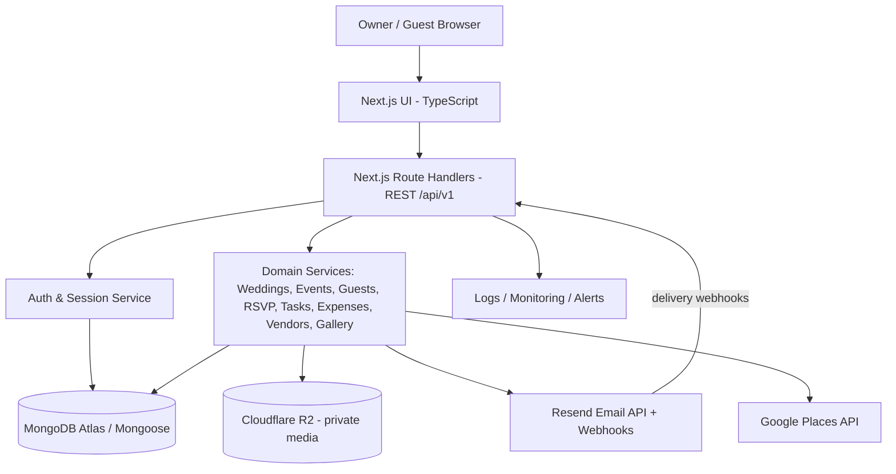

# Make My Marriage — System Design & Architecture
**Version:** 2.0 | **Status:** Draft for review

## 1. Architecture summary
A modular Next.js web application with server-side Route Handlers and a shared MongoDB Atlas database. Multi-tenancy is logical: each wedding-owned document contains `weddingId`; authorization is verified against the session-derived user and wedding owner. Media bytes reside in private Cloudflare R2; Resend handles transactional email; Google Places supports venue/vendor discovery.

## 2. Architecture diagram

## 3. Components and responsibilities
- **Next.js UI:** owner dashboard/workspace selection, guest invitation and public website views; responsive accessible frontend.
- **Route handlers:** versioned REST, authentication middleware, Zod input validation, error normalization, pagination, rate limiting.
- **Auth service:** Argon2id, email verification/reset, opaque session tokens, token hashing, expiry/revocation, CSRF protection.
- **Tenant authorization:** authenticate session; fetch wedding where `_id` and `ownerUserId` match session user; use verified weddingId for downstream queries.
- **Domain services:** business logic for event and guest assignment, RSVP deadline/capacity checks, dashboards, email, expense minor units, photo access.
- **MongoDB Atlas:** data collections and indexes, transactions where multi-document consistency is required and deployment supports them.
- **Cloudflare R2:** private object storage, unique object keys, presigned upload/download or authorized proxy.
- **Resend:** invitation/reminder/verification/reset mail and webhook delivery updates, processed idempotently.
- **Google Places:** venue/vendor discovery; persist only user-selected records.

## 4. Request lifecycle
1. Browser sends HTTPS request.
2. Middleware parses secure session cookie; session hash lookup validates active and unexpired session.
3. Route validates params/body with Zod and rate limits applicable operation.
4. Private route verifies wedding ownership; never trusts client-provided IDs as authorization.
5. Domain service queries with `weddingId` and entity ID; validates same-wedding relationships.
6. Service performs write; records activity/audit as appropriate.
7. API responds with stable JSON envelope; secrets and token values are not logged.

## 5. Data and tenancy
Shared collections, wedding-scoped documents, `weddingId` mandatory on wedding-owned records. Owner ID comes only from verified session. Cache keys, job payloads, object keys, and aggregates must include wedding scope. Guest token grants least-privilege access to only the guest's assigned events/RSVP and permitted album content. No cross-wedding queries.

## 6. Security controls
TLS; Argon2id; HttpOnly/Secure/SameSite cookies; CSRF protection; short-lived single-use hashed reset/verification tokens; random invitation/album tokens stored hashed; authentication and RSVP rate limits; Zod validation; safe output shaping; audit logs excluding secrets; strict CORS; private R2 objects; content signature and upload limits; webhook signature verification; secrets via environment/managed configuration.

## 7. Deployment and operations
- **Frontend/API:** Vercel deployment, environment-specific secrets.
- **Database:** MongoDB Atlas with least-privilege database credentials, backups and restore checks.
- **Storage:** Cloudflare R2 private bucket; lifecycle rules and cleanup process.
- **Email:** Resend domain verification and webhook endpoint.
- **Monitoring:** application error logs, latency, database saturation, failed mail/upload events, alerting; scrub personal/token data.
- **Environments:** local, staging, production; migrations/index deployment documented; no production secrets in source control.

## 8. Reliability, performance, and scale
Use pagination and bounded query results; weddingId-leading compound indexes; optimized RSVP aggregation; idempotency for webhooks/reminders; retry transient provider failures with bounded backoff; maintain status for async email/media actions. Scale Next.js serverless/API and MongoDB Atlas independently. Avoid claiming specific SLA until operational targets are approved.

## 9. Testing strategy
Unit tests for domain rules and Zod schemas; integration tests with database for tenant filters, uniqueness and RSVP; API auth and token lifecycle tests; Playwright owner/guest flows; security tests for IDOR/cross-wedding access, CSRF, rate limits, file upload validation, webhook replay; backup restore drill.

## 10. Architecture decisions
- One owner per wedding in initial release; no collaborator RBAC yet.
- Guests do not create platform accounts.
- REST JSON `/api/v1`; OpenAPI contract.
- MongoDB Atlas + Mongoose; validate inputs with Zod.
- Store UTC timestamps; display wedding IANA timezone.
- R2 contains bytes; MongoDB contains photo metadata.
- Future collaboration should add membership and explicit RBAC, not weaken ownership guards.
